# Can We Trust the Explanation? SHAP Attribution Stability in Telecom Churn Prediction

A reproducible study of whether SHAP explanations of churn classifiers are **stable**, **mutually corroborating**, and **useful**, on the IBM Telco Customer Churn dataset.

> **Scope note:** this folder is a standalone Python experiment. It is unrelated to the Go code in the rest of this repository, and nothing outside `SHAP_fml/` was changed.

## TL;DR

| | Finding |
|---|---|
| **Accuracy** | All three models land at test ROC-AUC 0.858–0.866, in line with leakage-free results in the literature. XGBoost beats LR by +0.008 AUC (paired 95% CI [0.001, 0.014]): statistically detectable, practically small. |
| **Robust drivers** | **Contract type** and **tenure** are the only features in the top 5 under all 9 model × method combinations (SHAP, permutation and drop-column for LR, RF and XGB). In the tree models they never leave the top 3 across all 80 refits. Partial dependence and the raw churn rates agree. These are the explanations you can defend. |
| **RQ1, cross-model** | The top-5 *sets* largely agree (4 of 5 features shared between any two models), but the *order* does not. LR ranks Contract #5; the trees rank it #1. Per customer, the top feature agrees between LR and RF for only **22%** of test customers. |
| **RQ2, stability** | Tree rankings are stable under seed changes (median ρ = 0.99) and moderately stable under bootstrap resampling (RF 0.94, XGB 0.86). **LR is the least stable** (median 0.87, minimum 0.51, bimodal). Its `MonthlyCharges` importance varies **9×** across refits because `MonthlyCharges` is almost a linear function of the subscribed services (R² = 0.999). |
| **RQ3, methods** | SHAP and permutation importance agree closely (ρ = 0.84–0.97). Both disagree sharply with **drop-column** importance (ρ = −0.13 to 0.39). `InternetService` and `MonthlyCharges` rank top-4 by SHAP, yet retraining without either costs **zero** AUC: the model *uses* them, but it does not *need* them. |
| **RQ4, correlation** | LR and the trees assign **opposite signs** to `MonthlyCharges` and `TotalCharges`. For one customer, LR says "low monthly bill → +0.99 log-odds of churn" and XGBoost says "→ −0.30". Adding a near-copy of `tenure` halves its SHAP and drops it from rank 1 to rank 6 with no change in AUC. |
| **Sanity check** | Removing the SHAP top-5 and retraining costs 4–9× more AUC than removing 5 random features, and removing the bottom 5 costs nothing. The *ranking* is faithful. But no single feature is indispensable: removing even the top-1 feature costs ≤ 0.008 AUC. |

**Bottom line:** trust SHAP for *which group of signals* the model leans on, Contract and tenure above all. Do not trust a single model's exact ordering, or any reading of an individual billing feature, without checking stability and agreement first.

---

## 1. Problem and research questions

Retention teams need to know *why* a customer is flagged, not just *that* they are. SHAP is the de facto tool, but its output depends on the model family, the training sample, the definition of "feature absence", and correlation between features.

- **RQ1:** Which features drive churn predictions, and do the top-ranked features agree across model families?
- **RQ2:** How stable is the SHAP ranking under bootstrap resampling, and under seed changes alone?
- **RQ3:** How does SHAP compare with permutation importance (and drop-column importance), and where do they disagree?
- **RQ4:** How do correlated features (tenure, MonthlyCharges, TotalCharges, and the structurally redundant service levels) affect attribution?

## 2. Literature review

### 2.1 Churn prediction
Churn modelling is a mature applied problem. Neslin et al. (2006) ran a churn-modelling tournament and found that method choice changes the profit of retention campaigns. Lemmens & Croux (2006) showed that bagging and boosting trees beat logistic regression on a large US wireless dataset. Verbeke et al. (2012) benchmarked many classifiers on telecom data and argued for profit-based evaluation over accuracy. Ascarza (2018) gave a result that matters for any "who to target" recommendation: customers with the highest churn *risk* are often not the ones most *responsive* to a retention offer. Risk models alone are therefore not targeting models. On the IBM Telco data used here, public studies and projects with leakage-safe pipelines typically report test ROC-AUC of about 0.82 to 0.85, and plain logistic regression is often competitive with boosted trees.[^telco] Considerably higher figures do appear. Because oversampling before splitting, or fitting preprocessing on the full data, is a common way to inflate such numbers, we audit leakage explicitly (Kaufman et al., 2012; Kapoor & Narayanan, 2023).

### 2.2 SHAP and its variants
SHAP (Lundberg & Lee, 2017) assigns each feature its Shapley value (Shapley, 1953) in a cooperative game whose "payout" is the model output. It unifies earlier additive attribution methods (e.g., Štrumbelj & Kononenko, 2014). TreeSHAP (Lundberg et al., 2020) computes exact values for tree ensembles in polynomial time. There is more than one "SHAP", and they differ in how they simulate an absent feature (Sundararajan & Najmi, 2020):
- **Interventional / marginal** SHAP replaces absent features with draws from a background sample, ignoring their dependence on present ones. It is "true to the model" (Chen et al., 2020), and Janzing et al. (2020) argue it is the causally correct choice for explaining a model's *computation*. Its cost is that it evaluates the model off the data manifold when features are correlated.
- **Observational / conditional** SHAP conditions on present features. It is "true to the data", but it can give credit to features the model never uses (Aas et al., 2021; Chen et al., 2020). TreeSHAP's `tree_path_dependent` mode approximates it using the training-cover statistics stored in the trees.

Our main analysis uses interventional SHAP for every model, so that differences between models are not differences between game definitions. We report path-dependent TreeSHAP as a contrast (RQ4).

### 2.3 Known failure modes of feature attribution
- **Correlated features.** Shapley credit for redundant features is split among them in ways that depend on the value function and on arbitrary choices made by the learner (Kumar et al., 2020; Aas et al., 2021). Permutation importance has a parallel problem: permuting one of two correlated features forces the model to extrapolate (Hooker, Mentch & Zhou, 2021; Strobl et al., 2007, 2008). Molnar et al. (2022) catalogue these pitfalls for model-agnostic methods generally.
- **Instability and the Rashomon effect.** Many near-equally accurate models can rely on different features (Breiman, 2001b; Fisher, Rudin & Dominici, 2019; Marx, Calmon & Ustun, 2020; Semenova, Rudin & Parr, 2022), so one model's explanation is one sample from a distribution. Alvarez-Melis & Jaakkola (2018) showed that local explanations can be fragile under small input perturbations. Visani et al. (2022) proposed stability indices for repeated runs of stochastic explainers. Goldwasser & Hooker (2024) argued that importance rankings need statistical guarantees, not point estimates.
- **The disagreement problem.** Krishna et al. (2022) showed that different explanation methods often disagree on the same model and that practitioners resolve this ad hoc. They proposed top-k *feature*, *rank* and *sign* agreement metrics, which we adopt.
- **Manipulability and axioms.** Slack et al. (2020) showed that SHAP and LIME can be gamed by an adversarial model. Huang & Marques-Silva (2023) argued that Shapley values can rank irrelevant features above relevant ones for some Boolean classifiers. Fryer, Strümke & Nguyen (2021) warned that the Shapley axioms are not the right axioms for *feature selection*. None of these is specific to our setting, but together they say that SHAP rankings are model descriptions that need corroboration.

### 2.4 How explanations are validated
Without ground-truth importances, the literature uses three kinds of corroboration, and we use all three:
1. **Agreement with independent methods**: permutation importance (Breiman, 2001a; Fisher et al., 2019), drop-column / leave-one-covariate-out retraining (Lei et al., 2018), linear coefficients.
2. **Removal-and-retrain benchmarks** (ROAR; Hooker, Erhan, Kindermans & Kim, 2019). If an attribution is faithful, retraining without the top-ranked features should cost more accuracy than removing random features. Retraining matters because removing a feature at test time conflates importance with distribution shift.
3. **Shape checks** with partial dependence (Friedman, 2001) and ICE curves (Goldstein et al., 2015). Global effect direction should agree with dependence plots of SHAP values.

### 2.5 Gap this study addresses
Most Telco-churn SHAP studies report one beeswarm plot from one model fitted once, then turn it into business recommendations. Few quantify (i) how much that ranking moves under resampling, (ii) whether it survives a change of model family or attribution method, or (iii) how correlated billing variables (tenure × MonthlyCharges ≈ TotalCharges) distort it. This study measures all three on the same data, with paired designs so that differences can be attributed to their source.
## 3. Experimental design

Every random choice is seeded from one constant (`SEED = 20261004`), and `src/run_experiment.py` regenerates every number in this report.

### 3.1 Data and leakage controls
- **Source:** IBM Telco Customer Churn (IBM sample data, the same file as the Kaggle copy), 7,043 customers, 19 predictors after dropping `customerID`, churn rate 26.5%. SHA-256 of the file: `16320c9c…5e91`.
- **Quirk handled:** 11 `TotalCharges` values are blank strings. All 11 have `tenure = 0` (never billed), so they are set to 0. This is a row-local fact, not a statistic estimated from data, so doing it before the split cannot leak.
- **Split:** stratified 60/20/20 train/validation/test (4,225 / 1,409 / 1,409; churn 26.5% in every part).
  - Train: model fitting and 5-fold CV tuning.
  - Validation: only for choosing the decision threshold.
  - Test: touched once for every reported metric and explanation.
- **No leakage by construction:** scaling and one-hot encoding live inside an sklearn `Pipeline`, so they are fitted on the training rows of each fit, including inside every CV fold and every bootstrap refit. We do no resampling such as SMOTE, so no synthetic rows can bleed across splits.
- **Leakage audit:**
  - The split indices are disjoint.
  - 10 test rows have feature vectors identical to some training row. These are distinct customers with identical, very common profiles (e.g., one-month DSL customers), not duplicated records. We keep them and report them.
  - We excluded no features as leaky. `TotalCharges` is a cumulative quantity, but it is known at prediction time, as it is in production.

### 3.2 Models and tuning
| Model | Search space (5-fold stratified CV on train, ROC-AUC) |
|---|---|
| Logistic regression (L2) | C ∈ 10^[-3, 2] (11 values) |
| Random forest (300 trees) | max_depth {6, 10, 14} × min_samples_leaf {5, 10, 20} × max_features {sqrt, 0.3} |
| XGBoost (hist, subsample = colsample = 0.8) | n_estimators {200, 400, 800} × learning_rate {0.02, 0.05} × max_depth {2, 3, 4} |

Tuning is deliberately light, as the brief asked: the object of study is the explanations, not leaderboard AUC.

### 3.3 Evaluation
- **Metrics on the test set:** ROC-AUC, PR-AUC (average precision; Saito & Rehmsmeier, 2015), F1, precision, recall, accuracy, Brier score.
- **Threshold:** the one that maximises F1 on the *validation* set.
- **Uncertainty:** 95% percentile bootstrap CIs (2,000 test resamples). Model differences use the *paired* bootstrap, the same resample for both models.

### 3.4 Explanations
- **Main explainer:** interventional SHAP for all three models (§2.2), with a background of 100 training rows.
  - `LinearExplainer` with an independent masker for LR.
  - Interventional `TreeExplainer` for RF and XGB.
  - Units: log-odds for LR and XGB; P(churn) for the sklearn RF, which is how sklearn defines its raw output. All cross-model comparisons use *ranks*, so the units do not matter.
- **Grouping:** one-hot columns are summed back to their original feature. Additivity makes this exact for interventional SHAP. Without it, a 4-level categorical feature competes with numerics as four fragments.
- **Global importance:** mean |φ| over the 1,409 test customers.
- **Implementation checks (passed):**
  - Additivity: base value + Σφ reproduces the model output to within floating-point error for all three models.
  - For LR, φ_j equals β_j (x_j − E_bg x_j) exactly.

### 3.5 Research-question protocols
- **RQ1, cross-model agreement:** Spearman ρ and Kendall τ between the 19-feature importance vectors. Top-5 *feature* agreement and *rank* agreement (Krishna et al., 2022). Direction agreement for the union of each model's top-10 one-hot columns (the sign of corr(x_col, φ_col)). Per-customer cross-model agreement (Spearman of |φ_i| and the top-1 feature).
- **RQ2, stability:**
  - Each model is refitted on **20 bootstrap resamples of the training set**, with the tuned hyper-parameters fixed. The bootstrap rows are the same for all three models (paired).
  - RF and XGB are also refitted on **20 seeds with the data fixed**, which separates algorithmic randomness from sampling variability. LR is deterministic, so a seed-only run would show zero variance.
  - Each refit explains the **same stratified 500-customer subset** of the test set against the **same background rows**. All variation therefore comes from the fitted model.
  - Global metrics: median and minimum of the 190 pairwise Spearman ρ, Kendall's W, mean pairwise top-3/top-5 Jaccard, and the distribution of the top-1 feature.
  - Local metrics: per-customer mean pairwise Spearman of |φ_i|, the rate at which a customer's top feature stays the same, and sign agreement of each customer's *material* contributions (|median φ| ≥ 10% of that customer's largest).
  - **Calibration of "disagreement":** cross-model ρ (all 400 bootstrap pairs) is compared against within-model ρ. This shows whether two models disagree more than one model disagrees with itself.
- **RQ3, method agreement:**
  - **Permutation importance** on the test set: drop in ROC-AUC, 30 repeats.
  - **Drop-column importance:** retrain without the feature and measure the test-AUC loss.
  - LR coefficients.
  - A 9×9 Spearman matrix over {SHAP, permutation, drop-column} × {LR, RF, XGB}.
- **RQ4, correlated features:**
  - (a) Correlation structure: tenure, MonthlyCharges, TotalCharges, plus *structural* redundancy. "No internet service" appears in 6 columns and is identical to `InternetService = No`; "No phone service" is identical to `PhoneService = No`.
  - (b) Remove `TotalCharges`, refit, and track where its SHAP credit goes.
  - (c) Grouped versus individual permutation of the billing trio.
  - (d) Interventional versus path-dependent TreeSHAP.
  - (e) A *near-duplicate* test: add `tenure_copy = tenure + N(0, (0.01·sd)²)` and see how each learner splits the credit.
- **Sanity check:**
  - ROAR-style retraining for k = 1…5: remove the top-k by SHAP, the top-k by permutation importance, the bottom-k by SHAP, or k random features (10 draws), then retrain and evaluate.
  - Partial dependence versus binned mean SHAP for the numerics (shape agreement by Spearman ρ).
  - PD versus mean SHAP per level for key categoricals.

## 4. Results

### 4.1 Model comparison (test set, n = 1,409, 374 churners)

| Model | Tuned params (5-fold CV AUC) | ROC-AUC [95% CI] | PR-AUC [95% CI] | F1 @ val-chosen threshold | Precision | Recall | Brier |
|---|---|---|---|---|---|---|---|
| Logistic regression | C = 3.16 (0.838) | 0.858 [0.835, 0.878] | 0.698 [0.649, 0.744] | 0.642 (t = 0.29) | 0.541 | 0.789 | 0.130 |
| Random forest | depth 6, leaf 20, max_features 0.3 (0.840) | 0.859 [0.838, 0.879] | 0.713 [0.668, 0.755] | 0.653 (t = 0.37) | 0.593 | 0.727 | 0.130 |
| XGBoost | 400 trees, lr 0.02, depth 2 (0.841) | **0.866** [0.845, 0.885] | **0.723** [0.678, 0.764] | 0.649 (t = 0.31) | 0.558 | 0.775 | **0.127** |
| Always-stay baseline | — | 0.500 | 0.265 | 0.000 | — | — | — |

Paired-bootstrap differences in ROC-AUC:

| Comparison | ΔAUC | 95% CI | Significant? |
|---|---|---|---|
| XGB − LR | +0.008 | [0.001, 0.014] | yes |
| XGB − RF | +0.007 | [0.003, 0.010] | yes |
| RF − LR | +0.001 | [−0.007, 0.009] | no |

The always-stay baseline reaches 73.5% accuracy, which is why we do not report accuracy as a headline metric. Results sit at or slightly above the range that leakage-safe public studies report (≈0.82–0.85). XGBoost's selected configuration sits at the shallow, slow-learning-rate edge of the grid: the signal is close to additive, which is also why LR is competitive. (`results/model_comparison.csv`, `paired_differences.csv`; Fig. 1)

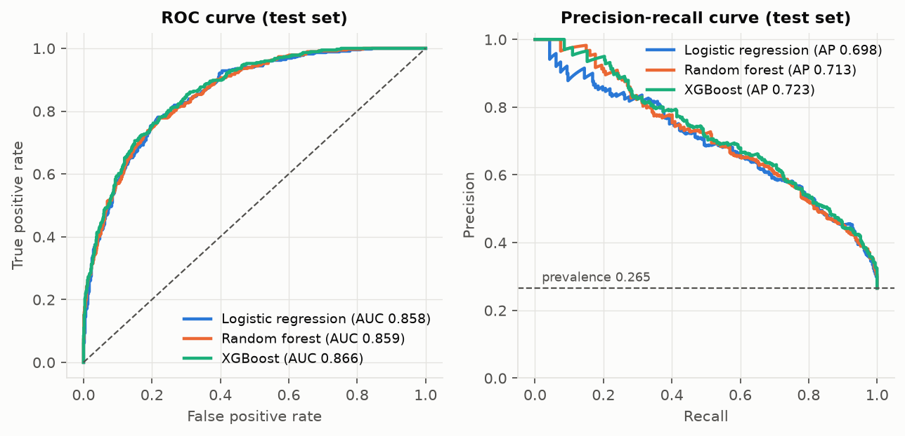

### 4.2 RQ1: What drives predictions, and do model families agree?

| Rank | LR | RF | XGB |
|---|---|---|---|
| 1 | tenure | **Contract** | **Contract** |
| 2 | MonthlyCharges | InternetService | tenure |
| 3 | InternetService | tenure | InternetService |
| 4 | TotalCharges | TotalCharges | MonthlyCharges |
| 5 | Contract | OnlineSecurity | OnlineSecurity |

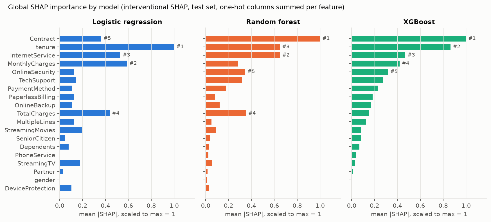

- **Global agreement:**

  | Pair | Spearman ρ | Same top-1 feature? | Top-5 feature agreement | Top-5 rank agreement |
  |---|---|---|---|---|
  | LR vs RF | 0.84 | no | 0.8 | 0.2 |
  | LR vs XGB | 0.73 | no | 0.8 | 0.2 |
  | RF vs XGB | 0.91 | yes | 0.8 | 0.4 |

  The models agree on *which* features matter but not on *how much*.
- **Direction agreement:** of the 14 one-hot columns that appear in any model's top 10, **12 have the same direction in all three models**. Month-to-month contract, fiber optic, electronic check, no online security and no tech support all push toward churn; long tenure and two-year contracts push away. The two exceptions are `MonthlyCharges` and `TotalCharges`, which have **opposite signs in LR and the trees** (§4.5).
- **Local agreement is much weaker than global agreement:**

  | Pair | Median per-customer Spearman of \|φ\| | Customers with the same top feature |
  |---|---|---|
  | LR vs RF | 0.74 | 22% |
  | LR vs XGB | 0.68 | 36% |
  | RF vs XGB | 0.89 | 63% |

  Two equally accurate models give a retention agent a *different headline reason* for most customers.

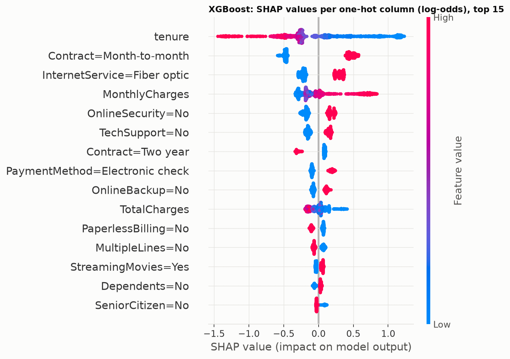

### 4.3 RQ2: Stability under resampling

| Refit regime (20 refits) | Test AUC (mean ± sd) | Median pairwise ρ (min) | Kendall's W | Top-1 feature (count / 20) | Top-3 Jaccard | Local: same top-1 feature | Material contributions that ever flip sign |
|---|---|---|---|---|---|---|---|
| LR, bootstrap | 0.855 ± 0.002 | **0.87 (0.51)** | 0.80 | tenure 15, MonthlyCharges 5 | 0.61 | 75% | **15.8%** |
| RF, bootstrap | 0.855 ± 0.003 | 0.94 (0.83) | 0.93 | Contract 20 | 0.95 | 84% | 3.0% |
| XGB, bootstrap | 0.861 ± 0.003 | 0.86 (0.66) | 0.86 | Contract 17, tenure 3 | 0.71 | 89% | 9.6% |
| RF, seed only | 0.859 ± 0.001 | 0.99 (0.98) | 0.99 | Contract 20 | 1.00 | 96% | 0.0% |
| XGB, seed only | 0.866 ± 0.000 | 0.99 (0.98) | 0.99 | Contract 20 | 0.75* | 98% | 0.0% |

\*XGB's top-3 Jaccard under seed changes is lowered by a near-tie between MonthlyCharges and InternetService for ranks 3–4. Its top-5 Jaccard is 0.94.

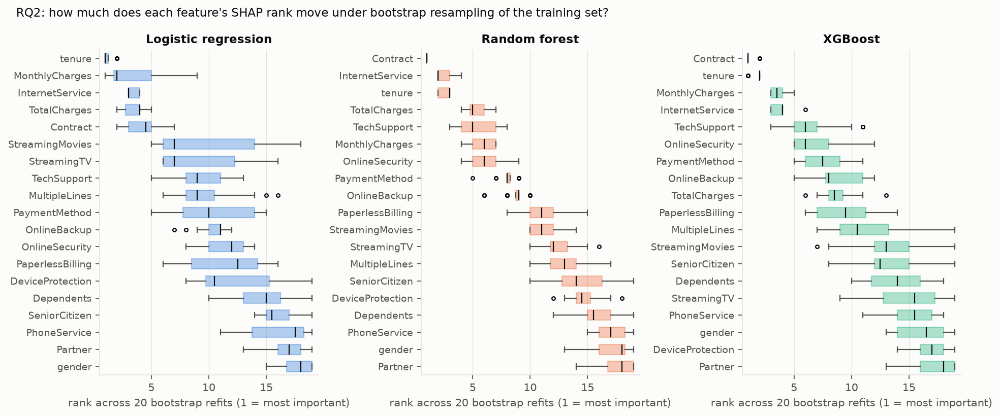
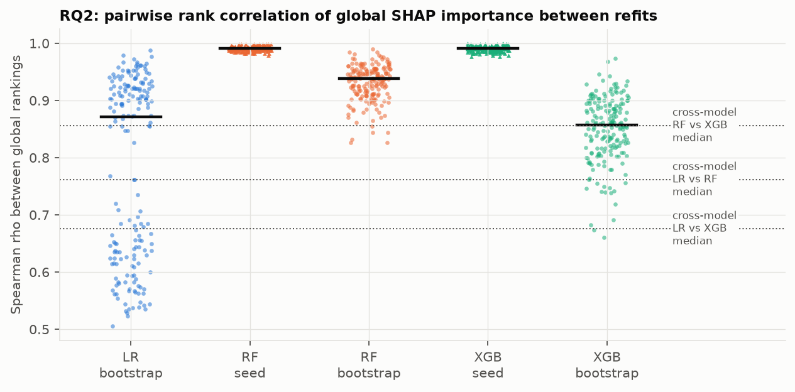

- **The data sample, not the random seed, drives instability.** With the data fixed, seed changes barely move the explanation (ρ ≈ 0.99). Resampling the training data moves it 7–16× more, measured as 1 − ρ. Reporting "we fixed the seed" therefore says almost nothing about explanation robustness.
- **Calibrating cross-model disagreement.** RF vs XGB disagree with a median ρ of 0.86, the same as XGB vs itself across bootstraps (0.86). So RF–XGB disagreement is indistinguishable from sampling noise. LR vs XGB (0.68) and LR vs RF (0.76) are clearly *below* within-model noise, so the LR/tree disagreement is real and structural.
- **Why LR is unstable, and bimodally so.** Across refits, LR's `MonthlyCharges` importance ranges from **0.15 to 1.36** log-odds, and it co-moves with InternetService and the Streaming dummies (r = 0.95–0.98). `MonthlyCharges` is 99.88% explained by the subscribed services, so its coefficient is nearly unidentified. Each bootstrap lands in one of two regimes: credit goes either to the price or to the services that make up the price. Pairs of refits in the same regime agree at ρ = 0.91; pairs in different regimes agree at only 0.66. The tree models are less affected because they split on one variable at a time. (`results/rq4_extra.json`)
- **Stable features:**
  - Contract, tenure and InternetService have rank sd ≤ 0.7 in the tree models. Contract never leaves the top 2 in RF or XGB.
  - The bottom of the ranking (gender, Partner, PhoneService) is consistently at the bottom.
  - The middle of the ranking (TechSupport, OnlineSecurity, PaymentMethod, PaperlessBilling, streaming services) is a shuffle: ranks move over spans of up to 13 places.
- **Local stability:** median per-customer ρ across bootstrap refits is 0.76 (LR), 0.88 (RF) and 0.80 (XGB). Customer explanations are less stable than global ones.

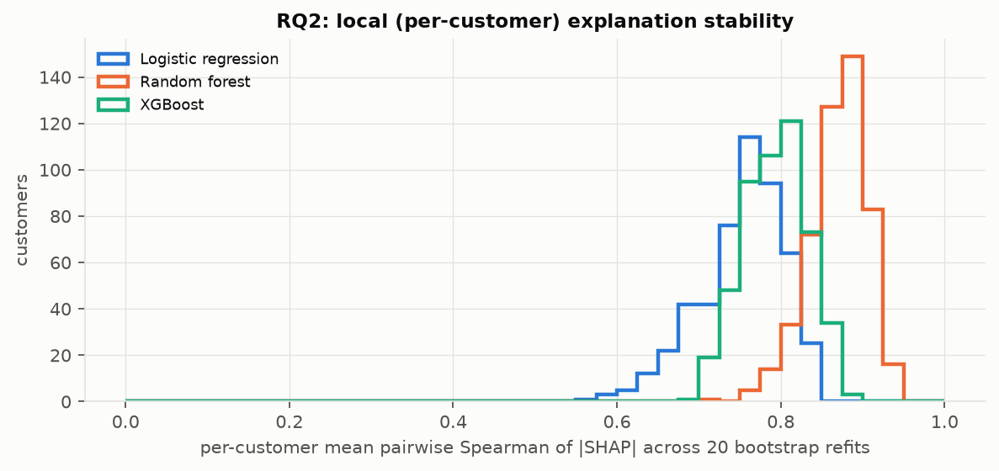

### 4.4 RQ3: SHAP vs permutation vs drop-column

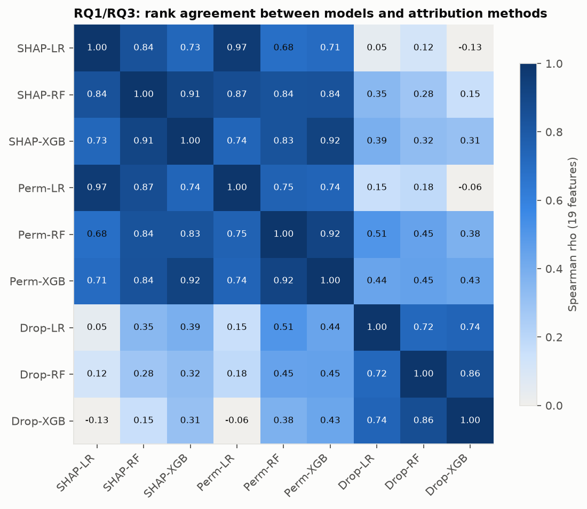

| Model | SHAP vs permutation ρ | SHAP vs drop-column ρ | Permutation vs drop-column ρ |
|---|---|---|---|
| LR | **0.97** | 0.05 | 0.15 |
| RF | **0.84** | 0.28 | 0.45 |
| XGB | **0.92** | 0.31 | 0.43 |

- **SHAP and permutation importance tell the same story.** Their top-5 *sets* are identical for every model. This is expected: both measure how much the fitted model's output relies on a feature with the others held as they are.
- **Drop-column importance tells a different story, and that is the informative disagreement.** Drop-column asks "how much worse is the best model we can build *without* this feature?"
  - The answer for `InternetService` and `MonthlyCharges` is *nothing*, or a slight improvement, in all three models (ΔAUC between −0.0012 and −0.0002). Yet SHAP and permutation rank them #2–#4.
  - Each can stand in for the other, along with the service dummies.
  - Contract is the most indispensable feature under drop-column for every model (ΔAUC 0.004–0.008).
  - Drop-column also ranks PaymentMethod, PaperlessBilling, OnlineSecurity and SeniorCitizen higher than SHAP does. These carry *unique* signal, even if they are not where the fitted model routes most of its output.
- **Most of the ranking's lower half is statistically indistinguishable from zero.** gender, Partner, Dependents and OnlineBackup (plus PhoneService for LR, and DeviceProtection and the streaming features for the trees) have permutation importance within 2 sd of zero. SHAP gives every feature a non-zero bar, so a SHAP bar chart alone overstates how many features "matter".
- **LR coefficients vs SHAP.** For LR, interventional SHAP is exactly β_j(x_j − E[x_j]), which we verified numerically. SHAP therefore adds nothing beyond coefficients scaled by feature spread. The standardised coefficients show the same opposed pairs: tenure −1.40 vs TotalCharges +0.66, and MonthlyCharges −0.83 vs Fiber +0.76.

### 4.5 RQ4: Correlated and redundant features

**Correlation structure.**
- Spearman ρ(tenure, TotalCharges) = 0.89, and TotalCharges ≈ tenure × MonthlyCharges (Pearson r = 0.9996).
- MonthlyCharges is a near-exact linear function of the 9 service variables (R² = 0.9988).
- "No internet service" in 6 columns is *identical* to `InternetService = No`, and "No phone service" is identical to `PhoneService = No`. LR spreads one effect equally over 7 copies (identical coefficients of −0.327). Grouping one-hot columns by original feature is what keeps this from inflating the dummies' apparent importance.

**(a) Sign reversal between model families.**
- LR: MonthlyCharges ↓ churn and TotalCharges ↑ churn, holding everything else fixed. Its partial dependence is a falling line for MonthlyCharges and a rising line for TotalCharges.
- Trees: the reverse, matching the raw data. Churn is 11% in the lowest MonthlyCharges quartile and 33–38% in the top two.
- LR's signs are *conditional* effects in a nearly collinear system. They are valid descriptions of LR, but they are not the univariate story, and they should never reach a retention deck as "higher bills reduce churn".
- The most confident false negative makes this concrete. For a one-year, no-internet customer paying $25.30 a month, LR attributes **+0.99** log-odds *toward* churn to MonthlyCharges, while XGBoost attributes **−0.30** to the same value.

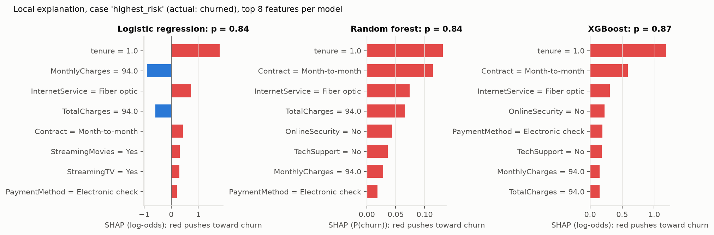
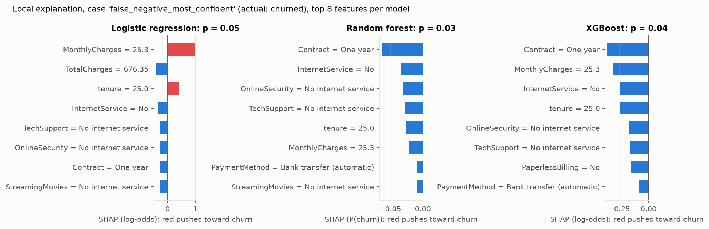

**(b) Removing TotalCharges.**
- Test AUC barely moves (≤ 0.0008 for every model). The feature carries no unique information.
- Its credit redistributes non-uniformly:
  - In the trees, tenure's SHAP goes *up* (RF +28%, XGB +11%).
  - In LR, tenure's SHAP goes *down* 40%, from 1.24 to 0.74. LR had been using tenure and TotalCharges as opposing "suppressor" terms that inflate each other's magnitudes.
- LR's SHAP magnitudes for the billing trio are therefore partly an artefact of collinearity. The signed contributions of tenure, MonthlyCharges and TotalCharges cancel heavily: the sum of the three mean-|φ| values is 2.51, while the mean |φ| of their sum is 1.01.

**(c) Grouped vs individual permutation of the billing trio.**

| Model | Sum of individual ΔAUC | Joint (grouped) ΔAUC | Reading |
|---|---|---|---|
| LR | 0.290 | 0.133 | The sum overstates the group by 2.2× |
| XGB | 0.083 | 0.075 | Roughly additive |
| RF | 0.045 | 0.063 | The sum *understates* the group |

- For LR, permuting one billing feature alone creates impossible combinations (e.g., tenure 70, TotalCharges $90), and LR's opposed coefficients extrapolate wildly on them, as described by Hooker, Mentch & Zhou (2021).
- For RF, the members substitute for each other, so permuting one at a time understates the group.
- When features are correlated, report importance for *groups*.

**(d) Interventional vs path-dependent TreeSHAP.** The two variants give almost the same ranking here (ρ = 0.993 for RF, 0.998 for XGB). The SHAP variant matters far less than the model family and the training sample.

**(e) Near-duplicate feature.**
- Adding `tenure_copy` (tenure plus 1% noise) leaves AUC unchanged, but tenure falls from rank 1 → 6 in LR, 2 → 5 in XGB and 3 → 4 in RF.
- The credit split is arbitrary: LR gives 67% to the copy, and XGB gives the copy 67% too.
- Feature engineering choices that add redundant variables can silently demote a real driver in a SHAP ranking.

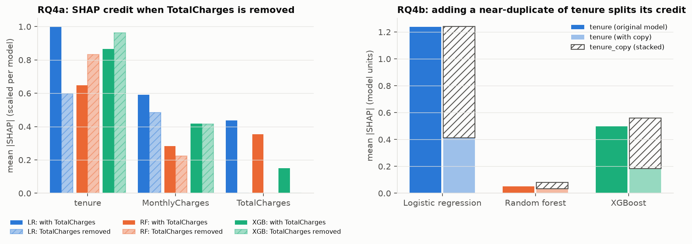

### 4.6 Sanity checks

**ROAR-style retraining** (Fig. 9). Removing features in SHAP order hurts every model more than removing random features, and removing the bottom-k by SHAP costs nothing.

| Model | Top-1 removed ΔAUC | Top-5 removed ΔAUC | Random-5 ΔAUC (mean of 10) | Bottom-5 removed ΔAUC |
|---|---|---|---|---|
| LR | 0.004 | **0.039** | 0.007 | ≈ 0 |
| RF | 0.008 | **0.060** | 0.007 | ≈ 0 |
| XGB | 0.004 | **0.029** | 0.007 | ≈ 0 |

- Permutation ordering gives the same curve almost everywhere.
- The ranking is *faithful in aggregate*, but no single feature is irreplaceable. Losing the #1 feature costs less than 0.01 AUC, so statements like "contract type drives churn" describe where the model routes its output, not a bottleneck it cannot do without.

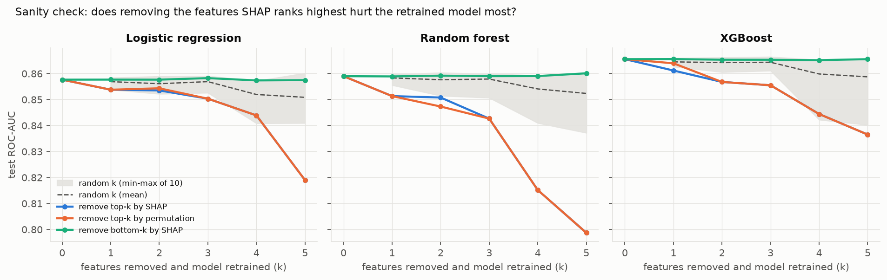

**Shape checks.**
- For all 9 model × numeric-feature pairs, the binned mean SHAP and the partial dependence agree in shape (Spearman ρ ≥ 0.94).
- For the categoricals, the PD level ordering matches the SHAP level ordering for Contract, InternetService and PaymentMethod in all models.
- Monthly contract, fiber optic and electronic check are the high-churn levels. Their raw churn rates are 43%, 42% and 45%, against 3%, 7% and 15–19% for the safest levels.

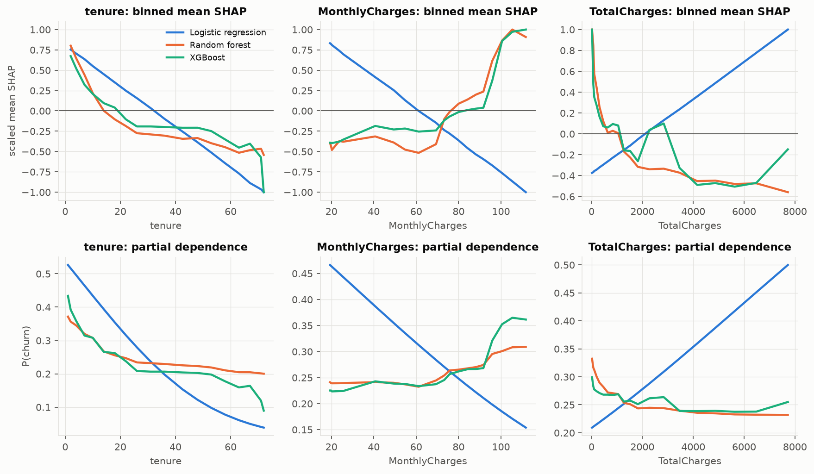

---

## 5. What this means for retention, and what it does not

**Defensible recommendations.** Each of these is supported by every model, every attribution method, drop-column retraining and the raw data.

1. **Prioritise month-to-month customers early in their tenure.** Contract type and tenure are the only drivers in the top 5 under every model and method, and they are stable under resampling. Churn is 53% in the first 6 months and 43% on month-to-month contracts, against 3% on two-year contracts. Contract migration offers, such as discounted 12- or 24-month terms, are the natural lever to *test*.
2. **Review the fiber-optic experience.** Fiber customers churn at 42% versus 19% on DSL, and the effect points the same way in every model. Because it is substitutable with MonthlyCharges, though, we cannot tell from these models whether the problem is *price* or *product*. That needs a survey or an experiment, not SHAP.
3. **Bundle protection services.** No OnlineSecurity and no TechSupport consistently push toward churn, and they carry unique signal under drop-column. Bundling them is a candidate lever, ranked lower in confidence.
4. **Encourage automatic payment.** Electronic check is consistently a high-churn level, at 45% versus 15–17% for automatic payments, and it carries unique signal (drop-column rank 4).

**What not to do with these explanations.**
- Do not report a single model's *exact* top-10. Ranks 5–15 shuffle under resampling.
- Do not interpret `MonthlyCharges` or `TotalCharges` individually. Their sign depends on the model family.
- Do not show per-customer "top reason" text without disclosing that another, equally accurate model would give a different top reason for most customers.
- Do not read high-risk scores as "will respond to an offer". Ascarza (2018) shows that risk and treatment response differ, and the lever for *targeting* is an uplift model fitted on campaign data.

**Practical protocol we would recommend.**
1. Fit at least two model families.
2. Run ~20 bootstrap refits and report rank intervals, not point ranks.
3. Group correlated or structurally redundant features before ranking them.
4. Corroborate the top-k with drop-column or ROAR.
5. Only promote drivers that survive all of the above.

## 6. Limitations

- **SHAP explains the model, not the world.** Every "driver" here is a statement about how fitted models map inputs to scores. Causal claims, e.g., that moving customers to annual contracts *reduces* churn, need experiments. Contract choice is self-selected, so the association is confounded by customer intent.
- **One dataset, one snapshot.** The data are a fictional IBM sample from one period with no timestamps. The temporal validation that production churn models need (train on earlier cohorts, test on later ones) is impossible here, and the results may not transfer to other operators.
- **Light tuning.** XGBoost's chosen configuration sits at the edge of its grid. A wider search might gain a few thousandths of AUC; it is unlikely to change the explanation findings, which are driven by data structure.
- **Units differ across models.** RF SHAP is in probability units (sklearn's raw output) and LR/XGB SHAP is in log-odds. All cross-model comparisons use ranks for this reason, but magnitudes in the figures are only comparable within a model.
- **Approximation details.**
  - Interventional SHAP uses a 100-row background sample.
  - RF additivity holds to within 0.005 probability units. This is consistent with float32 split thresholds in sklearn trees; LR and XGB are exact to within 1e-5.
  - The stability study explains a stratified 500-customer subset to keep 100 interventional TreeSHAP runs tractable.
- **The bootstrap is an approximation of sampling variability.** Bootstrap fits see about 63% unique rows, so they are slightly weaker (AUC −0.003). The stability numbers are therefore, if anything, mildly pessimistic.
- **Post-hoc analyses are labelled.** `src/extra_checks.py` (the R² of MonthlyCharges on services, and the LR bimodality diagnosis) was written *after* inspecting the main results, to explain a pattern in them. Treat it as exploratory, not as pre-planned confirmatory analysis.
- **Ten test rows have feature vectors identical to training rows.** They are distinct customers with common profiles, not leakage, but they make test performance very slightly optimistic.

## 7. Reproducing

```bash
cd SHAP_fml
pip install -r requirements.txt
python src/run_experiment.py   # ~10 min on 4 cores; downloads the CSV into data/ (git-ignored)
python src/extra_checks.py     # post-hoc diagnostics
python src/make_figures.py     # regenerates figures/
```

| Path | Contents |
|---|---|
| `src/common.py` | Data loading and cleaning, split, pipelines, SHAP helpers |
| `src/run_experiment.py` | Everything in §4 |
| `results/*.csv, *.json` | Every number quoted above |
| `results/shap_main.npz` | Per-customer SHAP values for all three models |
| `results/stability_local.npz` | Per-refit, per-customer aggregated SHAP values |
| `results/run_log.txt` | Log of the run that produced these results |

Everything is seeded (`SEED = 20261004`). The dataset's SHA-256 is recorded in `results/data_info.json`.

## 8. References

- Aas, K., Jullum, M., & Løland, A. (2021). Explaining individual predictions when features are dependent: More accurate approximations to Shapley values. *Artificial Intelligence*, 298, 103502.
- Alvarez-Melis, D., & Jaakkola, T. S. (2018). On the robustness of interpretability methods. *ICML Workshop on Human Interpretability*. arXiv:1806.08049.
- Ascarza, E. (2018). Retention futility: Targeting high-risk customers might be ineffective. *Journal of Marketing Research*, 55(1), 80–98.
- Breiman, L. (2001a). Random forests. *Machine Learning*, 45(1), 5–32.
- Breiman, L. (2001b). Statistical modeling: The two cultures. *Statistical Science*, 16(3), 199–231.
- Chen, H., Janizek, J. D., Lundberg, S., & Lee, S.-I. (2020). True to the model or true to the data? arXiv:2006.16234.
- Chen, T., & Guestrin, C. (2016). XGBoost: A scalable tree boosting system. *KDD*.
- Fisher, A., Rudin, C., & Dominici, F. (2019). All models are wrong, but many are useful: Learning a variable's importance by studying an entire class of prediction models simultaneously. *JMLR*, 20(177), 1–81.
- Friedman, J. H. (2001). Greedy function approximation: A gradient boosting machine. *Annals of Statistics*, 29(5), 1189–1232.
- Fryer, D., Strümke, I., & Nguyen, H. (2021). Shapley values for feature selection: The good, the bad, and the axioms. *IEEE Access*, 9, 144352–144360.
- Goldstein, A., Kapelner, A., Bleich, J., & Pitkin, E. (2015). Peeking inside the black box: Visualizing statistical learning with plots of individual conditional expectation. *JCGS*, 24(1), 44–65.
- Goldwasser, J., & Hooker, G. (2024). Statistical significance of feature importance rankings. arXiv:2401.15800.
- Hooker, G., Mentch, L., & Zhou, S. (2021). Unrestricted permutation forces extrapolation: Variable importance requires at least one more model, or there is no free variable importance. *Statistics and Computing*, 31, 82.
- Hooker, S., Erhan, D., Kindermans, P.-J., & Kim, B. (2019). A benchmark for interpretability methods in deep neural networks. *NeurIPS*.
- Huang, X., & Marques-Silva, J. (2023). The inadequacy of Shapley values for explainability. arXiv:2302.08160.
- Janzing, D., Minorics, L., & Blöbaum, P. (2020). Feature relevance quantification in explainable AI: A causal problem. *AISTATS*.
- Kapoor, S., & Narayanan, A. (2023). Leakage and the reproducibility crisis in machine-learning-based science. *Patterns*, 4(9).
- Kaufman, S., Rosset, S., Perlich, C., & Stitelman, O. (2012). Leakage in data mining: Formulation, detection, and avoidance. *ACM TKDD*, 6(4).
- Kendall, M. G., & Babington Smith, B. (1939). The problem of m rankings. *Annals of Mathematical Statistics*, 10(3), 275–287.
- Krishna, S., Han, T., Gu, A., Wu, S., Jabbari, S., & Lakkaraju, H. (2022). The disagreement problem in explainable machine learning: A practitioner's perspective. arXiv:2202.01602 (TMLR, 2024).
- Kumar, I. E., Venkatasubramanian, S., Scheidegger, C., & Friedler, S. (2020). Problems with Shapley-value-based explanations as feature importance measures. *ICML*.
- Lei, J., G'Sell, M., Rinaldo, A., Tibshirani, R. J., & Wasserman, L. (2018). Distribution-free predictive inference for regression. *JASA*, 113(523), 1094–1111.
- Lemmens, A., & Croux, C. (2006). Bagging and boosting classification trees to predict churn. *Journal of Marketing Research*, 43(2), 276–286.
- Lundberg, S. M., & Lee, S.-I. (2017). A unified approach to interpreting model predictions. *NeurIPS*.
- Lundberg, S. M., Erion, G., Chen, H., et al. (2020). From local explanations to global understanding with explainable AI for trees. *Nature Machine Intelligence*, 2, 56–67.
- Marx, C., Calmon, F., & Ustun, B. (2020). Predictive multiplicity in classification. *ICML*.
- Molnar, C., König, G., Herbinger, J., et al. (2022). General pitfalls of model-agnostic interpretation methods for machine learning models. In *xxAI – Beyond Explainable AI*, LNAI 13200, Springer.
- Neslin, S. A., Gupta, S., Kamakura, W., Lu, J., & Mason, C. H. (2006). Defection detection: Measuring and understanding the predictive accuracy of customer churn models. *Journal of Marketing Research*, 43(2), 204–211.
- Saito, T., & Rehmsmeier, M. (2015). The precision-recall plot is more informative than the ROC plot when evaluating binary classifiers on imbalanced datasets. *PLoS ONE*, 10(3), e0118432.
- Semenova, L., Rudin, C., & Parr, R. (2022). On the existence of simpler machine learning models. *ACM FAccT*.
- Shapley, L. S. (1953). A value for n-person games. In *Contributions to the Theory of Games II*, 307–317.
- Slack, D., Hilgard, S., Jia, E., Singh, S., & Lakkaraju, H. (2020). Fooling LIME and SHAP: Adversarial attacks on post hoc explanation methods. *AIES*.
- Strobl, C., Boulesteix, A.-L., Zeileis, A., & Hothorn, T. (2007). Bias in random forest variable importance measures. *BMC Bioinformatics*, 8, 25.
- Strobl, C., Boulesteix, A.-L., Kneib, T., Augustin, T., & Zeileis, A. (2008). Conditional variable importance for random forests. *BMC Bioinformatics*, 9, 307.
- Štrumbelj, E., & Kononenko, I. (2014). Explaining prediction models and individual predictions with feature contributions. *Knowledge and Information Systems*, 41(3), 647–665.
- Sundararajan, M., & Najmi, A. (2020). The many Shapley values for model explanation. *ICML*.
- Verbeke, W., Dejaeger, K., Martens, D., Hur, J., & Baesens, B. (2012). New insights into churn prediction in the telecommunication sector: A profit driven data mining approach. *EJOR*, 218(1), 211–229.
- Visani, G., Bagli, E., Chesani, F., Poluzzi, A., & Capuzzo, D. (2022). Statistical stability indices for LIME: Obtaining reliable explanations for machine learning models. *Journal of the Operational Research Society*, 73(1), 91–101.

[^telco]: Examples, consulted October 2026: [ashandx/telco-churn-classification](https://github.com/ashandx/telco-churn-classification), [NihanShaik15/CUSTOMER-CHURN](https://github.com/NihanShaik15/CUSTOMER-CHURN) (≈0.84), [Nikunj-Saini/Telco-Churn-Prediction](https://github.com/Nikunj-Saini/Telco-Churn-Prediction) (0.825). For a much higher reported figure (AUC 0.932) with SHAP analysis, see [Explainable AI-driven customer churn prediction, PMC12929532](https://www.ncbi.nlm.nih.gov/pmc/articles/PMC12929532/). We did not audit its pipeline. Recent preprints also study SHAP ranking instability under collinearity, e.g., [arXiv:2605.21492](https://arxiv.org/html/2605.21492) and [arXiv:2603.22346](https://arxiv.org/pdf/2603.22346); they are not peer-reviewed and were not relied on.
