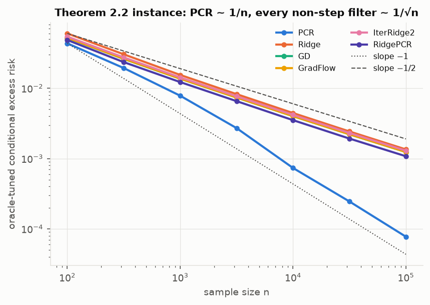
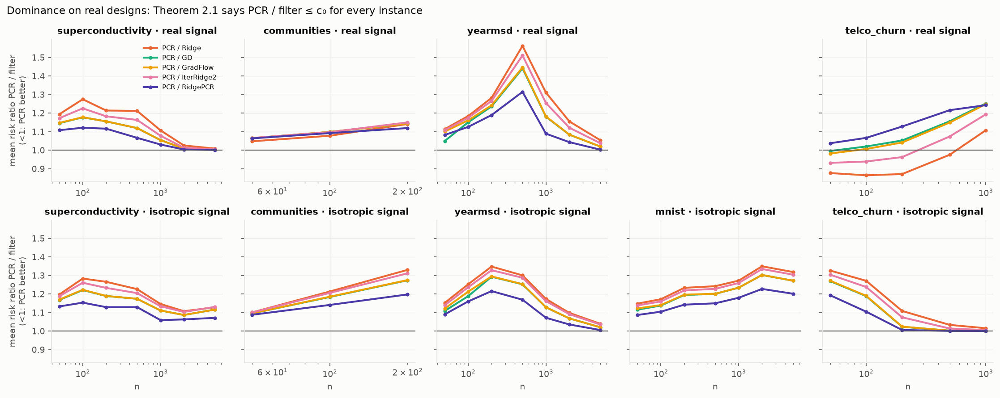
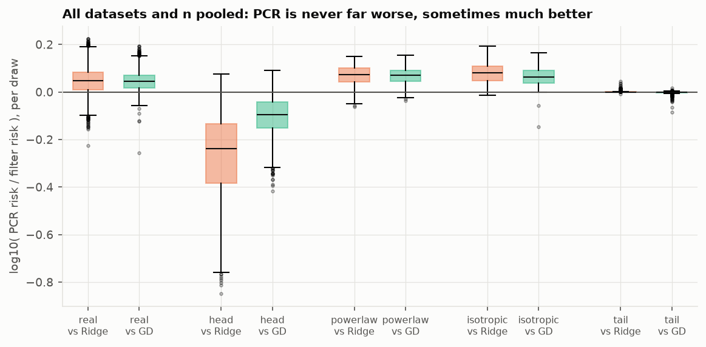
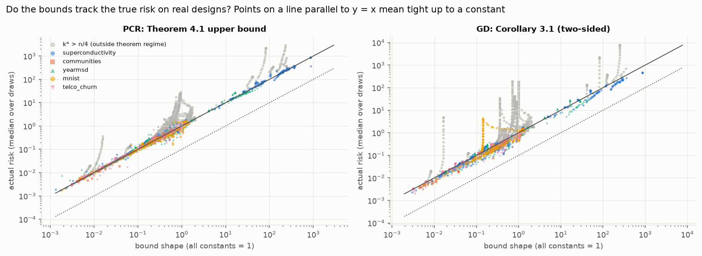
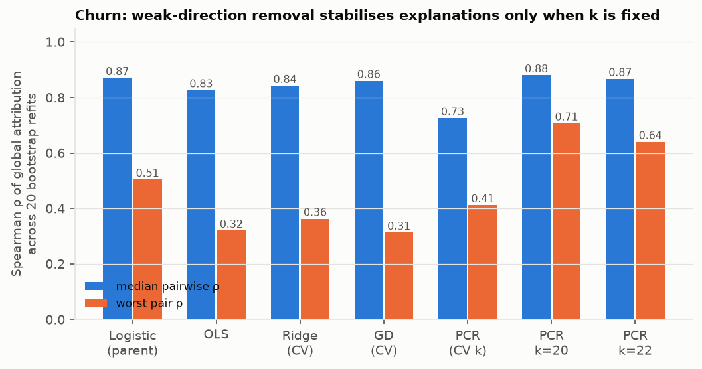

# Extension: Does "PCR Dominates All Monotone Spectral Filters" Hold on Real Data?

An empirical test, on five real-world designs, of the new instance-wise risk bounds for principal component regression (PCR) in

> **Kim, J., Fu, H., Bartlett, P. L., Lee, J. D., & Wu, J. (2026).** *Principal Component Regression Dominates all Monotone Spectral Filters for Linear Regression.* arXiv:2609.39440 (30 Sep 2026). UC Berkeley and Google DeepMind (Bartlett).

The paper is purely theoretical and contains no experiments. This folder checks its three main claims against data that violate its assumptions (non-Gaussian, dependent, rank-deficient designs; misspecified targets; CV-tuned rather than oracle-tuned hyperparameters). It then connects the result back to the SHAP-stability findings in the parent study.

> **Which paper?** The request mentioned "two authors, one from DeepMind". The closest match in a full arXiv search of PCR papers is this five-author paper, whose senior author, Peter Bartlett, is at Google DeepMind. Two-author candidates are summarised in §2 in case one of them was meant:
> - Tsigler & Bartlett (2023), the ridge bounds this paper builds on, also with Bartlett.
> - Hucker & Wahl (2023), the previous best PCR bounds.
> - Green & Romanov (2025), exact PCR asymptotics.

## TL;DR

| Claim in the paper | What we find on real designs |
|---|---|
| **Thm 2.1, dominance.** Oracle-tuned PCR's risk is at most a constant c₀ times that of *any* monotone spectral filter (ridge, GD, gradient flow, iterated ridge, ridge-PCR…), on *every* instance. | **Holds, with a small constant.** Across 5 datasets × 5 signals × up to 7 sample sizes, the worst observed c₀ is **1.56** (mean risk) and **1.68** (single draw). That holds on misspecified real labels (1.57) and on designs with PC-score excess kurtosis up to 26, far from the Gaussian design the theorem assumes. |
| **Thm 2.2–2.3, strong dominance.** There are instances where PCR beats every non-step filter by a polynomial factor (risk n⁻¹ vs n⁻¹ᐟ²). | **Reproduced on the paper's own construction:** slopes −0.93 vs −0.54. **But on real designs it is rare.** PCR wins outright in only 19% of draws, and its median risk is 10% above the best alternative. A large advantage appears only for "spiked" signals concentrated in the top PCs: up to **5× better than ridge** on MNIST. |
| **Thm 4.1 and Cor 3.1, instance-wise tight bounds** for PCR and GD. | **Tight on real designs once inside the theorem's regime (k* ≤ n/4).** With all unknown constants set to 1, the PCR upper-bound shape is within **0.84×–1.47×** of the true risk for 90% of 3,263 configurations. Bound failures concentrate at the interpolation peak (k* ≈ n), which the theorem excludes. |
| *(Not in the paper)* Does dominance survive realistic tuning? | **No: CV costs PCR more than it costs ridge.** With 5-fold CV, ridge or a smooth filter wins in **22 of 22** real-label settings. CV-tuned PCR is 1.0–1.7× worse than the best CV-tuned alternative. Choosing a discrete k is noisier than choosing a continuous λ. |
| *(Bridge to the SHAP study)* Does zeroing weak directions stabilise churn explanations? | **Only with k fixed.** CV-tuned PCR gives the *least* stable SHAP ranking (median ρ 0.73) because CV re-chooses k. With k fixed at 20, it gives the *most* stable ranking of any model (median 0.88, worst 0.71 vs 0.51 for the parent study's logistic regression). But k = 20 and k = 22 name different top drivers. |

---

## 1. What the paper proves

**Setting.** Linear regression with excess risk E(w) = ‖w − w*‖²_Σ. A *spectral filter* g with g(0) = 0 gives the estimator ŵ_g = Σᵢ g(λ̂ᵢ)/λ̂ᵢ · ûᵢûᵢᵀ Xᵀy/n. The filter is *monotone* if 0 ≤ g ≤ 1 and g is non-decreasing. The class includes:

| Estimator | Filter g(z) |
|---|---|
| PCR | 1{z > ρ} |
| Ridge | z/(z+λ) |
| GD (t steps) | 1 − (1−ηz)ᵗ |
| Gradient flow | 1 − e^{−tz} |
| Iterated ridge | 1 − (λ/(z+λ))^p |
| Ridge-PCR | min(1, z/ρ) |

**Theorem 2.1 (dominance).** For Gaussian design with bounded SNR, with probability 0.99: inf_ρ E[E(ŵ^pcr_ρ) | X] ≤ c₀ · E E(ŵ_g) for every monotone g. PCR is therefore instance-wise optimal, up to a constant, among monotone filters, and admissible.

**Theorem 2.2 (strong dominance).** On an explicit sequence of instances, PCR's risk is O(1/n) while every filter that is not close to a step function has risk Ω(1/√n). This covers ridge, GD, gradient flow, iterated ridge and ridge-PCR. GD and ridge are therefore *inadmissible*.

The intuition the authors give: PCR's advantage is in **variance**. It can set weak spectral directions *exactly* to zero, while any smooth filter must partially fit them.

**Theorem 4.1 (PCR risk).** With α_k = Σ_{i>k}λᵢ²/n + (Σ_{i>k}λᵢ/n)² and k* = min{k : 1.1ρ + Σ_{i>k}λᵢ/(c₂n) ≥ λ_{k+1}}, the upper bound is:

  E[E(ŵ^pcr_ρ)|X] ≲ (α_{k*} + λ²_{k*+1} log(1/δ)/n) ‖w*‖²_{Σ⁻¹_{0:k*}} + ‖w*‖²_{Σ_{k*:∞}} + σ² min{D, k̂}/n.

There is a matching-form lower bound at a slightly shifted index r*. These are *head bias + tail bias + variance* decompositions in the style of Bartlett et al. (2020) and Tsigler & Bartlett (2023).

**Corollary 3.1 (GD).** Two-sided bounds that match up to constants. They separate the optimisation error ‖(I−ηΣ)ᵗw*‖²_{Σ_{0:k*}} from implicit tail regularisation and variance.

**What the paper leaves open, and we test:**
1. Its dominance results assume **Gaussian design**; the GD/PCR bounds assume independent sub-Gaussian whitened coordinates.
2. Everything assumes a **well-specified** linear model.
3. All comparisons are at the **oracle** hyperparameter.
4. Constants c₀…c₄ are unspecified, so it is unknown whether "up to constants" means 1.5× or 1000×.

## 2. Literature context

- **Classical PCR.** PCR is old (Hotelling, 1957; Kendall, 1957; Massy, 1965), and so is the warning against it. Jolliffe (1982) and Hadi & Ling (1998) gave real examples where the response depends on *low-variance* PCs, so dropping them is harmful. Frank & Friedman (1993) compared PCR, PLS and ridge in simulations and found ridge usually best. That is not a contradiction of Thm 2.1, which only promises "within a constant", and our results quantify that constant.
- **Dominance in fixed design.** Dhillon, Foster, Kakade & Ungar (2013) proved PCR's risk is at most 4× ridge's at comparable regularisation, and can be arbitrarily smaller. Ali, Kolter & Tibshirani (2019) showed gradient flow is within 1.69× of ridge.
- **Random design.**
  - Bartlett, Long, Lugosi & Tsigler (2020) and **Tsigler & Bartlett (2023)** give instance-wise tight bounds for ridge and minimum-norm interpolation. These are the head/tail/effective-rank machinery used here. Tsigler & Bartlett is a two-author paper with Bartlett.
  - Wu, Bartlett, Kakade, Lee & Yu (2026, COLT) show GD strongly dominates ridge.
  - Kim et al. (2026) close the chain: PCR ≺ GD ≺ ridge.
- **Previous PCR bounds.**
  - **Hucker & Wahl (2023)** (two authors) gave high-probability upper bounds comparing PCR with an oracle PCR. They also showed that empirical eigenvalue inflation acts as self-induced regularisation. Kim et al. improve these bounds and add lower bounds.
  - **Green & Romanov (2025, Annals of Statistics)** (two authors) derived exact proportional-asymptotic risk formulas using multi-resolvent random-matrix tools.
  - Bing, Bunea, Strimas-Mackey & Wegkamp (2021) studied adaptive rank selection in latent factor models. Agarwal, Shah & Shen (2025) analysed PCR's out-of-sample prediction with applications to synthetic controls.
  - Recent work modifies PCR to soften its hard cutoff: calibrated PCR (Wu, Zhu, Cao & Shi, 2025) and de-floored PCR (Zhao, 2026).
- **Spectral regularisation in general.** Bauer, Pereverzev & Rosasco (2007); Gerfo et al. (2008); Blanchard & Mücke (2018) give minimax rates under source and capacity conditions. These are worst-case results, which the instance-wise dominance framework refines.

## 3. Experimental design

**Finite-population protocol.** Each real dataset is treated as the *population*: x is drawn uniformly from its N rows. Then:
- Σ = XᵀX/N is the *exact* population covariance (features centred, and standardised for the tabular datasets).
- w* = Σ⁺ E[xy] is the exact population least-squares solution.
- For any linear predictor, E(w) = ‖w − w*‖²_Σ exactly, even when y is not linear in x.

Training samples of size n are drawn i.i.d. from the population. The designs are real; nothing is assumed Gaussian.

**Datasets.**

| Dataset | N | d | rank | Effective rank r₀ = tr Σ/λ₁ | Spectrum decay λᵢ ∝ i^{−a} | Max PC-score excess kurtosis | Linear R² of real target |
|---|---|---|---|---|---|---|---|
| Superconductivity (UCI) | 21,263 | 81 | 81 | 2.6 | a ≈ 2.0 | 4.9 | 0.74 |
| Communities & Crime (UCI) | 1,994 | 99 | 99 | 4.0 | 1.5 | 8.4 | 0.69 |
| YearPredictionMSD (UCI) | 515,345 | 90 | 90 | 8.7 | 0.7 | **25.9** | 0.24 |
| MNIST pixels | 70,000 | 719 | 713 | 10.3 | 1.5 | 0.4 | (semi-synthetic only) |
| Telco churn (parent study) | 7,043 | 46 | **23** | 3.5 | 1.1 | 1.3 | 0.28 |

Under Gaussian design the excess kurtosis column would be 0. Telco's one-hot encoding is rank-deficient (rank 23 of 46), which is the collinearity behind the parent study's unstable SHAP rankings.

**Targets.**
- **Real labels** (four datasets): the dataset's own response, which is misspecified, with heteroscedastic residuals.
- **Semi-synthetic** y = xᵀw* + N(0, σ²), with x real and five signals:
  - *real*: the population OLS w* and residual σ² of the real target.
  - *head*: Σ-energy spread evenly over the top 5 PCs. This is spiked, like the paper's separation instance.
  - *powerlaw*: Σ-energy ∝ i^{−1.5}.
  - *isotropic*: w* ~ N(0, I), the setting in which ridge is the Bayes estimator.
  - *tail*: Σ-energy on the bottom 10% of PCs, the Jolliffe-type adversarial case.

  Synthetic signals have ‖w*‖²_Σ = σ² = 1.
- For semi-synthetic targets we compute the conditional risk E[E(ŵ)|X] **in closed form**: bias ((g−1)∘a)ᵀA((g−1)∘a) plus variance (σ²/n)Σᵢ gᵢ² Aᵢᵢ/λ̂ᵢ. This is exactly the quantity in the theorems, with no Monte Carlo noise over ε.

**Estimators.** All six filters are computed exactly in the empirical eigenbasis over dense grids:
- PCR: every k.
- Ridge, iterated ridge and ridge-PCR: 211 log-spaced values.
- GD: 241 stopping times up to 10¹⁰.
- Gradient flow: 251 values.

The GD stepsize uses the paper's stable rule η = 1/(2(λ₁ + tr Σ/n)). Closed forms were checked against explicit GD iterations, sklearn `Ridge`, explicit PCR and a 20,000-draw Monte Carlo; all agree to about 1e−12.

**Tuning.** We use both the **oracle** (minimum over the grid, which is what the theorems compare) and **5-fold CV** on the training sample (real labels only, with η and grid scale estimated from the sample).

**Sizes.**
- n ∈ {50, 100, 200, 500, 1000, 2000, 5000}, capped at N/4.
- 40 draws per (dataset, signal, n) for semi-synthetic targets; 60 for real labels.
- Bound tracking covers 36 PCR thresholds and 31 GD stopping times per draw, on the first 15 draws.

**Positive control.** The Theorem 2.2 instance from the paper's Appendix D.4, with Gaussian design, n from 100 to 100,000 and 12 draws each.

**Seed.** Everything uses `SEED = 20261004`.

## 4. Results

### 4.1 Positive control: the separation instance reproduces



| Estimator (oracle-tuned) | Log-log slope of risk vs n |
|---|---|
| PCR | **−0.93** |
| PCR at the paper's prescribed threshold ρₙ | **−0.97** |
| Ridge | −0.55 |
| GD | −0.54 |
| Gradient flow | −0.54 |
| Iterated ridge | −0.54 |
| Ridge-PCR | −0.55 |

Theory predicts −1 against −½. At n = 100,000, PCR's risk is **14× smaller** than the best non-step filter's (ridge-PCR), and 16× smaller than GD's (`results/separation_slopes.csv`).

### 4.2 Theorem 2.1 on real designs: dominance holds with c₀ ≈ 1.6




- **Worst case.** The largest PCR / filter risk ratio observed anywhere, over all datasets, signals, n and filters, is **1.56** on mean risk and **1.68** on a single draw. The 99th percentile per draw is 1.39. It is 1.57 on misspecified real labels. The worst cases are yearmsd, the most heavy-tailed design. The theorem's conclusion survives on designs that violate its Gaussian assumption.
- **PCR is usually slightly worse.** It is the best filter in only **19%** of semi-synthetic draws and **12%** of real-label draws. Its median risk is 1.10× the best alternative (1.16× on real labels).
- **The signal decides who wins.** Median PCR / ridge ratio by signal:

  | Signal | Median PCR / ridge | PCR beats ridge in |
  |---|---|---|
  | head (spiked) | **0.58** | 98% of draws |
  | real | 1.12 | 17% |
  | powerlaw | 1.19 | 3% |
  | isotropic | 1.20 | 0.3% |
  | tail | ≈ 1 | — |

  For the tail signal, nothing is learnable at these n and every method is at the zero predictor.
- **Strong dominance does not show up as a rate gap on real spectra.** Fitted slopes of risk vs n for PCR are within ±0.14 of the best alternative's in every dataset × signal cell (`results/risk_slopes.csv`). The largest PCR advantage is MNIST, head signal, n = 5,000:

  | PCR better than… | Factor |
  |---|---|
  | Ridge | 5.1× |
  | Iterated ridge | 3.3× |
  | GD | 1.9× |
  | Ridge-PCR | 1.08× |

  The polynomial separation needs a sharp spectral gap with the signal on one side and a √n-dimensional flat bulk on the other. Real spectra decay smoothly, so the gap stays a constant factor.
- **GD's stepsize condition fails on heavy tails.** On yearmsd, 6.7% of samples have η·λ̂_max > 1 even though η satisfies the paper's population-level stability condition. On those samples GD oscillates or diverges. We report these samples rather than clip them.

### 4.3 Theorem 4.1 and Corollary 3.1: the bound shapes are tight on real data, inside their regime



Each point is one (dataset, signal, n, hyperparameter). It plots the median true risk over draws against the bound expression with **every unknown constant set to 1** (c₁…c₄ = 1, δ = 0.01). A bound that is tight up to constants puts the points on a line parallel to y = x.

| | Configurations | log₁₀(risk / bound shape), 5th / 50th / 95th percentile | Risk more than 3× the shape |
|---|---|---|---|
| PCR upper bound, k* ≤ n (c₃ = 1) | 4,485 | −0.06 / 0.03 / 0.57 | 7.7% |
| **PCR upper bound, k* ≤ n/4 (c₃ = 4)** | 3,263 | **−0.08 / 0.01 / 0.17** | **0.06%** |
| GD two-sided shape, c₃ = 1 | 3,432 | −0.23 / 0.05 / 1.42 | 15.2% |
| **GD two-sided shape, c₃ = 4** | 2,246 | **−0.27 / 0.02 / 0.21** | **1.4%** |

- **PCR.** Inside the regime the theorem actually covers (k* ≤ n/c₃ for a large constant), the PCR bound shape predicts the true risk to within a factor of **0.84–1.47 for 90% of configurations**, on five real, non-Gaussian designs. The paper only claims tightness "up to constants". Empirically, those constants are close to 1.
- **Lower bound.** The PCR lower-bound shape never exceeds the true risk by more than 1.5×, even though it is proved only for Gaussian design.
- **Where the bounds fail.** The grey points are k* close to n, i.e. near-interpolation where the variance explodes (the double-descent peak). This is precisely the regime the theorem's k* ≤ n/c₃ condition excludes. The remaining GD outliers in the c₃ = 4 regime are MNIST at large t with n ≈ d.

### 4.4 Beyond the paper: CV tuning erases PCR's advantage in practice

Results on real labels, from `results/real_labels_oracle_vs_cv.csv`:

| Dataset | Oracle PCR / ridge | CV PCR / ridge | CV cost for PCR (CV / oracle) | CV cost for ridge (CV / oracle) | Best family under CV |
|---|---|---|---|---|---|
| Superconductivity, n = 500 | 1.22 | 1.38 | 1.26 | 1.11 | Ridge |
| YearMSD, n = 500 | 1.57 | 1.68 | 1.15 | 1.08 | Ridge |
| Communities, n = 100 | 1.01 | 1.19 | 1.34 | 1.14 | Ridge |
| **Telco churn, n = 200** | **0.77** | **1.10** | **1.63** | 1.15 | Ridge-PCR |

- Under 5-fold CV, ridge wins 16 of 22 real-label settings; ridge-PCR, GD or iterated ridge win the other 6. **PCR never wins.**
- Telco shows the pattern most clearly. With oracle tuning PCR beats ridge by 23%. After CV, PCR loses by 10%, because CV's choice of k costs it 1.4–2.0× in risk against 1.1–1.4× for ridge.
- Risk is a discontinuous function of k, so CV's error in choosing k is costlier than its error in a continuous λ.
- **Implication:** the dominance theorem is about *what PCR can do with the right k*. Its practical value depends on a rank-selection rule whose error is not covered by the theorem. Data-adaptive selection, as in Bing et al. (2021), is the missing piece.

### 4.5 Bridge to the SHAP study: weak-direction removal and explanation stability

The parent study found logistic regression's SHAP ranking unstable, with bimodal bootstrap ρ (median 0.87, worst 0.51). The cause was that `MonthlyCharges` is 99.9% explained by the service dummies, which is a near-null direction of Σ. Kim et al. say PCR's edge comes from zeroing exactly such directions. We refit linear-probability models on the *same* 20 bootstrap samples, explanation subset and background rows. Linear SHAP is φᵢⱼ = βⱼ(zᵢⱼ − z̄ⱼ), grouped by feature.



| Model | Median ρ | Worst ρ | Top-1 feature (count of 20) | `MonthlyCharges` importance max/min | Test AUC |
|---|---|---|---|---|---|
| Logistic regression (parent) | 0.87 | 0.51 | tenure 15, MonthlyCharges 5 | 9× | 0.855 |
| OLS (min-norm) | 0.83 | 0.32 | MonthlyCharges 12, InternetService 6, TotalCharges 2 | **917×** | 0.848 |
| Ridge (CV) | 0.84 | 0.36 | TotalCharges 9, MonthlyCharges 5, … | 7.8× | 0.850 |
| GD (CV) | 0.86 | 0.31 | tenure 12, MonthlyCharges 5, … | 7.5× | 0.850 |
| PCR (CV, k ∈ 20–23) | 0.73 | 0.41 | TotalCharges 10, MonthlyCharges 7, tenure 3 | 7.3× | 0.848 |
| **PCR, k = 20 fixed** | **0.88** | **0.71** | **tenure 20** | **1.3×** | 0.850 |
| PCR, k = 22 fixed | 0.87 | 0.64 | TotalCharges 18, … | 1.5× | 0.849 |

1. **Any regularisation tames the near-null direction.** The swing in `MonthlyCharges` importance falls from 917× under OLS to about 7× under ridge, GD or CV-PCR.
2. **CV-tuned PCR is the *least* stable model.** It re-chooses k between 20 and 23 across bootstraps, and crossing a component boundary rewrites the attributions discontinuously. This is the explanation-side version of §4.4's tuning cost.
3. **With k fixed, PCR is the *most* stable explainer tested.** k = 20 gives the best worst-case ρ of any model (0.71) and a unanimous top-1 feature.
4. **The explanation still depends on k.** k = 20 says *tenure* drives churn, and k = 22 says *TotalCharges*. Each is stable on its own, but they disagree with each other, at equal AUC.

   Collinear credit simply moves from a stochastic choice (which bootstrap sample) to a modelling choice (which k). This sharpens the parent study's conclusion: report importance for the *group* {tenure, TotalCharges, MonthlyCharges}, not for its members.

## 5. Limitations

- **Real designs, but synthetic noise in E1–E3.** "Real-signal" semi-synthetic targets use real x, w* and σ², with Gaussian homoscedastic noise. The real-label runs remove that assumption, and their conclusions match.
- **The finite population is not the true population.** Treating the dataset as the population makes Σ and w* exact, but sampling with replacement from N rows differs from sampling new data. For Communities (N = 1,994) we cap n at N/4.
- **Bound constants.** The c₃ = 4 cut-off is our choice, motivated by the theorem's "k* ≤ n/c₃ for a large constant". Results for c₃ = 1 are reported alongside. The comparison uses median-over-draws risk against the high-probability bound.
- **Grids, not true infima.** Oracle risks are minima over dense finite grids (PCR uses every k). Grid resolution can only *understate* the smooth filters' oracle performance by a negligible amount, which would slightly inflate the reported c₀.
- **Monotone filters only.** Momentum, SGD and PLS are outside the theorem and outside this test.
- **Post-hoc variant.** The fixed-k PCR variants in §4.5 (k = 20, 22) were added *after* seeing that CV-PCR was unstable, to diagnose why. They are diagnostic, not a pre-registered comparison.

## 6. Reproducing

```bash
cd SHAP_fml/pcr_bounds/src
python run_separation.py          # E3, ~1 min
python run_realdata.py            # E1 + E2, ~2 min on 4 cores; downloads ~230 MB to ../data (git-ignored)
python run_churn_stability.py     # E4; needs the parent study's results/
python analyze.py                 # tables + figures
```

| File | Contents |
|---|---|
| `src/spectral.py` | Filters, exact risks, and the Theorem 4.1 / Corollary 3.1 bound shapes |
| `src/data.py` | Loaders and design diagnostics |
| `results/summary.json` | Every headline number above |
| `results/dominance_*.csv*` | Per-draw and mean-risk ratios |
| `results/bound_tracking*.csv.gz` | Risk vs bound shape for each configuration |
| `results/real_labels_oracle_vs_cv.csv` | Oracle vs CV comparison |
| `results/churn_stability.json` | Churn explanation-stability results |

## 7. References

- Agarwal, A., Shah, D., & Shen, D. (2025). On model identification and out-of-sample prediction of principal component regression: Applications to synthetic controls. *JMLR*. arXiv:2010.14449.
- Ali, A., Kolter, J. Z., & Tibshirani, R. J. (2019). A continuous-time view of early stopping for least squares regression. *AISTATS*.
- Bartlett, P. L., Long, P. M., Lugosi, G., & Tsigler, A. (2020). Benign overfitting in linear regression. *PNAS*, 117(48), 30063–30070.
- Bauer, F., Pereverzev, S., & Rosasco, L. (2007). On regularization algorithms in learning theory. *Journal of Complexity*, 23(1), 52–72.
- Bing, X., Bunea, F., Strimas-Mackey, S., & Wegkamp, M. (2021). Prediction under latent factor regression: Adaptive PCR, interpolating predictors and beyond. *JMLR*, 22. arXiv:2007.10050.
- Blanchard, G., & Mücke, N. (2018). Optimal rates for regularization of statistical inverse learning problems. *Foundations of Computational Mathematics*, 18, 971–1013.
- Dhillon, P. S., Foster, D. P., Kakade, S. M., & Ungar, L. H. (2013). A risk comparison of ordinary least squares vs ridge regression. *JMLR*, 14, 1505–1511.
- Frank, I. E., & Friedman, J. H. (1993). A statistical view of some chemometrics regression tools. *Technometrics*, 35(2), 109–135.
- Gerfo, L. L., Rosasco, L., Odone, F., De Vito, E., & Verri, A. (2008). Spectral algorithms for supervised learning. *Neural Computation*, 20(7), 1873–1897.
- Green, A., & Romanov, E. (2025). The high-dimensional asymptotics of principal component regression. *Annals of Statistics*, 53(4). arXiv:2405.11676.
- Hadi, A. S., & Ling, R. F. (1998). Some cautionary notes on the use of principal components regression. *The American Statistician*, 52(1), 15–19.
- Hotelling, H. (1957). The relations of the newer multivariate statistical methods to factor analysis. *British Journal of Statistical Psychology*, 10, 69–79.
- Hucker, L., & Wahl, M. (2023). A note on the prediction error of principal component regression in high dimensions. arXiv:2212.04959.
- Jolliffe, I. T. (1982). A note on the use of principal components in regression. *Journal of the Royal Statistical Society C*, 31(3), 300–303.
- Kendall, M. G. (1957). *A Course in Multivariate Analysis*. Griffin.
- **Kim, J., Fu, H., Bartlett, P. L., Lee, J. D., & Wu, J. (2026).** Principal component regression dominates all monotone spectral filters for linear regression. arXiv:2609.39440.
- Massy, W. F. (1965). Principal components regression in exploratory statistical research. *JASA*, 60(309), 234–256.
- Tsigler, A., & Bartlett, P. L. (2023). Benign overfitting in ridge regression. *JMLR*, 24(123), 1–76.
- Wu, J., Bartlett, P. L., Kakade, S. M., Lee, J. D., & Yu, B. (2026). Risk comparisons in linear regression: Implicit regularization dominates explicit regularization. *COLT*.
- Wu, Y. F., Zhu, Y., Cao, L., & Shi, N. (2025). Calibrated principal component regression. arXiv:2510.19020.
- Zhao, P. (2026). De-floored principal component regression: When rank selection alone is insufficient for prediction. arXiv:2607.16638.

**Data:**
- UCI Machine Learning Repository: Superconductivity (Hamidieh, 2018), Communities and Crime (Redmond, 2009), YearPredictionMSD (Bertin-Mahieux et al., 2011).
- MNIST (LeCun et al., 1998).
- IBM Telco Customer Churn.
